<div align="center">


# ✈️ Jetly Mobile — Luxury Private Jet & Live Flight Booking App

### *Built with React Native 0.76 • Expo SDK 52 (New Architecture) • 60fps Native-Driver Animations • Live Multi-Currency & Aviation Weather APIs*

[](https://reactnative.dev/)
[](https://expo.dev/)
[](https://github.com/soumitra69/Flight_Booking_App)
[](#%EF%B8%8F-live-public-api-integrations-zero-api-key-required)
[](https://github.com/soumitra69/Flight_Booking_App)

<br />


<p align="center">
  <b>👆 Live Auto-Sliding iPhone 16 Pro Showcase</b> — Watch all 8 native mobile screens slide automatically across the viewport.
</p>

[📱 **Mobile Screen Gallery**](#-mobile-app-screens--sliding-portrait-gallery) •
[✨ **Key Features**](#-key-mobile-engineering-features) •
[🏗️ **System Architecture**](#%EF%B8%8F-system-architecture--data-flow) •
[🛰️ **Live APIs**](#%EF%B8%8F-live-public-api-integrations-zero-api-key-required) •
[📂 **Folder Structure**](#-project-structure) •
[🚀 **Quick Start**](#-getting-started)

</div>

---

## 📱 Mobile App Screens — Sliding Portrait Gallery

> **Swipe / Scroll horizontally →** to inspect all **10 native portrait mobile screens** (`393 × 852` iPhone 16 Pro retina viewport) featuring the sticky **VIP Top Header** and **5-Tab Bottom Navigation Bar** (`Sky Hub`, `Book Jet`, `Charters`, `Services`, `My Tickets`). Click any phone screen to view full resolution.

<table>
  <tr>
    <td align="center" width="230">
      <a href="./assets/screenshots/mobile-01-sky-hub.png">
        
      </a>
      <br />
      <b>01 • Sky Hub & Landing</b>
      <br />
      <sub>60fps Runway Descent & HUD</sub>
    </td>
    <td align="center" width="230">
      <a href="./assets/screenshots/mobile-02-screen-slider.png">
        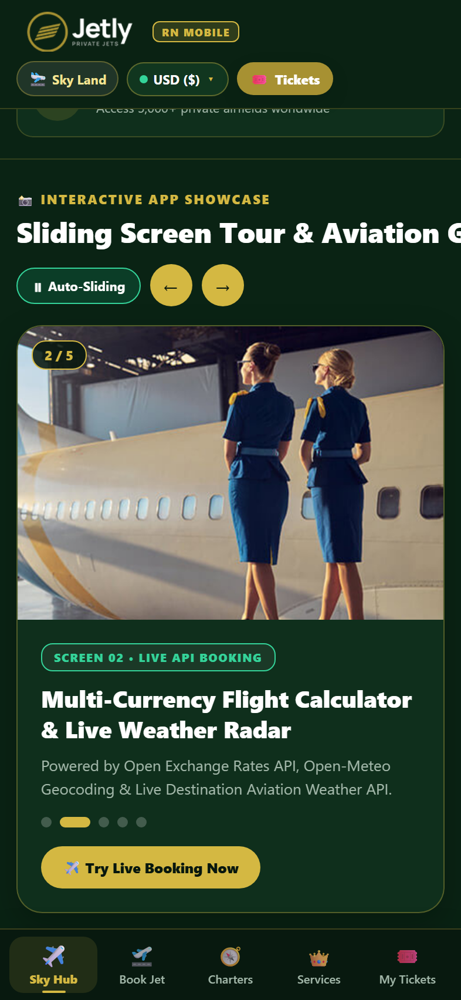
      </a>
      <br />
      <b>02 • App Screen Slider</b>
      <br />
      <sub>Auto-Sliding Tour & Controls</sub>
    </td>
    <td align="center" width="230">
      <a href="./assets/screenshots/mobile-03-live-booking.png">
        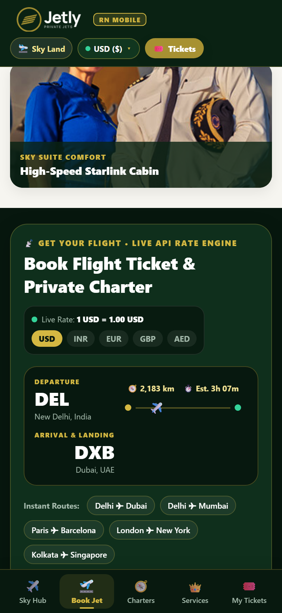
      </a>
      <br />
      <b>03 • Live Flight Radar</b>
      <br />
      <sub>DEL ✈ DXB & Currency Strip</sub>
    </td>
    <td align="center" width="230">
      <a href="./assets/screenshots/mobile-04-jet-tiers.png">
        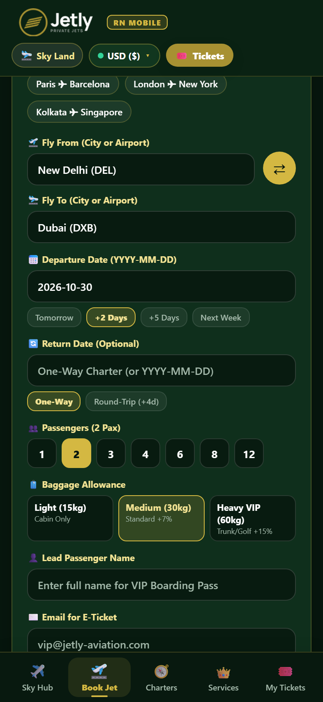
      </a>
      <br />
      <b>04 • Route & Pax Form</b>
      <br />
      <sub>Geocoding Search & Baggage</sub>
    </td>
    <td align="center" width="230">
      <a href="./assets/screenshots/mobile-05-boarding-pass.png">
        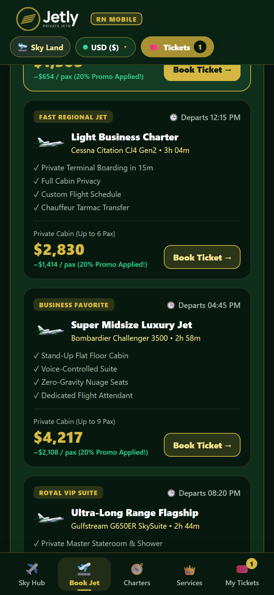
      </a>
      <br />
      <b>05 • 4-Tier Jet Pricing</b>
      <br />
      <sub>20% Promo Applied Rates</sub>
    </td>
  </tr>
  <tr>
    <td align="center" width="230">
      <a href="./assets/screenshots/mobile-06-services-fleet.png">
        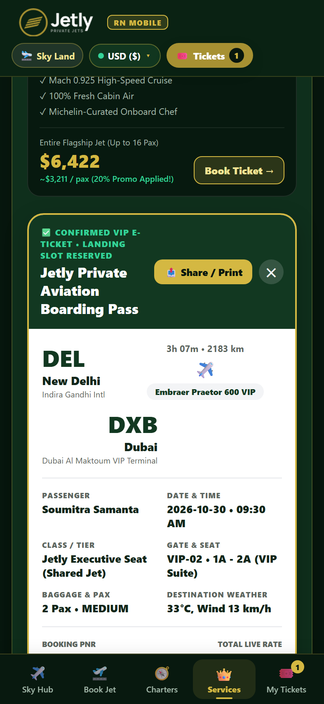
      </a>
      <br />
      <b>06 • VIP Boarding Pass</b>
      <br />
      <sub>Confirmed E-Ticket & Share</sub>
    </td>
    <td align="center" width="230">
      <a href="./assets/screenshots/mobile-08-tickets-wallet.png">
        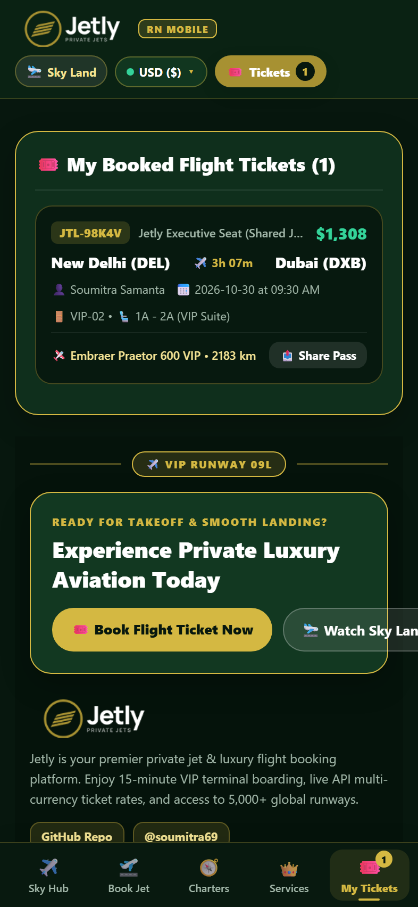
      </a>
      <br />
      <b>07 • My Tickets Wallet</b>
      <br />
      <sub>Saved Passes & VIP Footer</sub>
    </td>
    <td align="center" width="230">
      <a href="./assets/screenshots/mobile-07-charters-offers.png">
        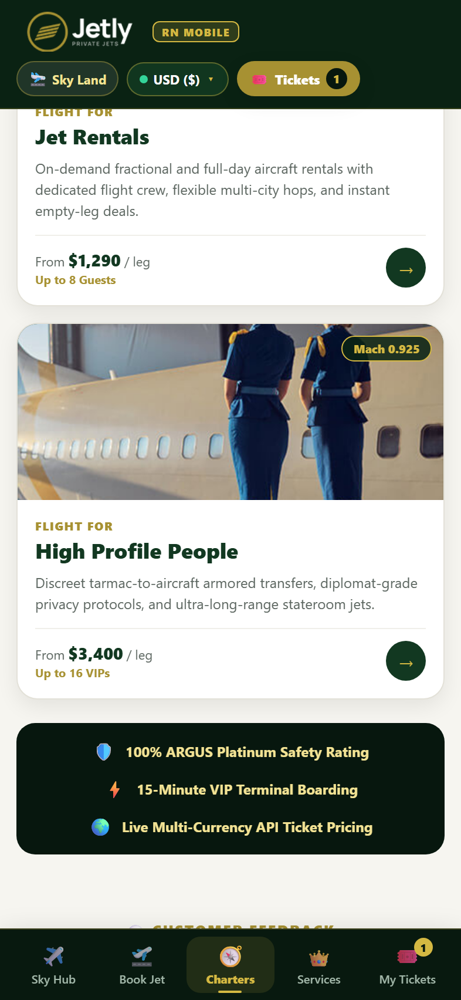
      </a>
      <br />
      <b>08 • Executive Services</b>
      <br />
      <sub>Mach 0.925 Fleet & Safety</sub>
    </td>
    <td align="center" width="230">
      <a href="./assets/screenshots/mobile-09-empty-leg-charters.png">
        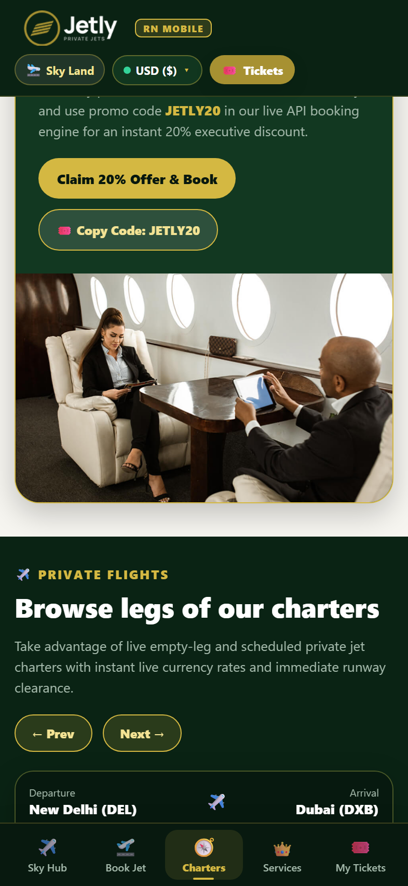
      </a>
      <br />
      <b>09 • Empty-Leg Deals</b>
      <br />
      <sub>JETLY20 Promo & Charters</sub>
    </td>
    <td align="center" width="230">
      <a href="./assets/screenshots/mobile-10-popular-destinations.png">
        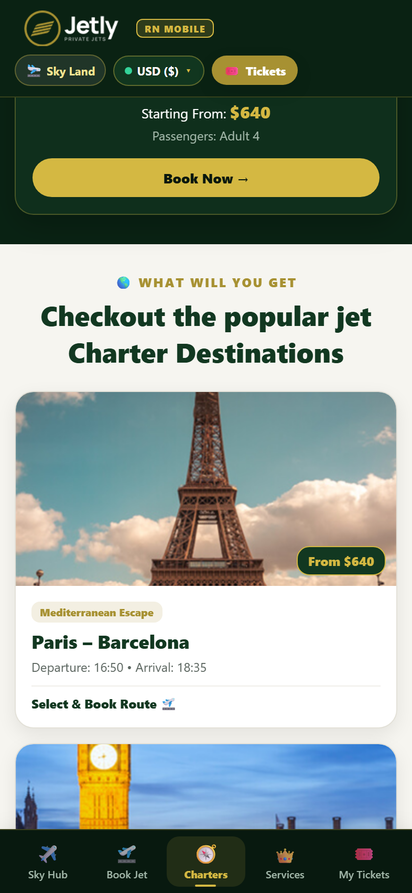
      </a>
      <br />
      <b>10 • Jet Destinations</b>
      <br />
      <sub>Paris, Dubai & Zurich Legs</sub>
    </td>
  </tr>
</table>

<details>
<summary><b>🖥️ Click to Expand Tablet / Desktop Responsive Screens (8 Wide Views)</b></summary>
<br />

<div align="center">
  
</div>

| Screen 01 • Sky Landing Hero | Screen 02 • About & Gallery | Screen 03 • Live API Booking | Screen 04 • 4-Tier Jet Rates |
| :---: | :---: | :---: | :---: |
| 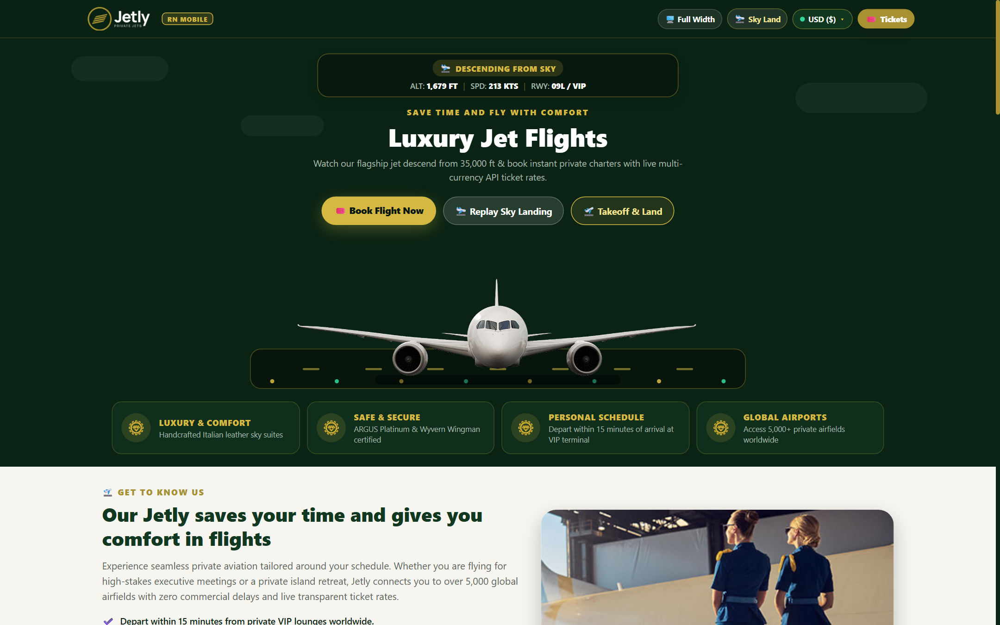 | 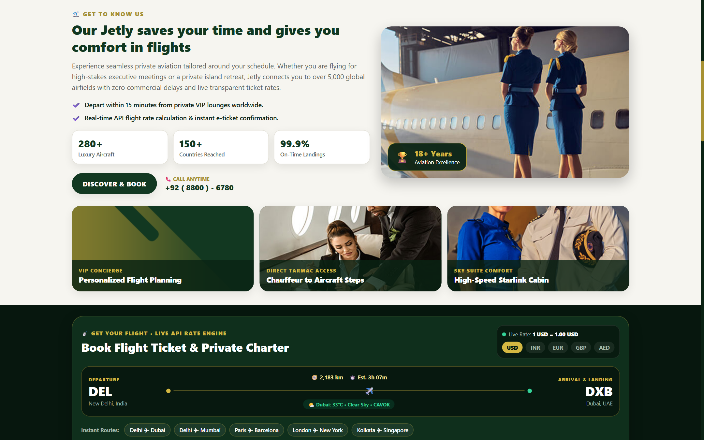 | 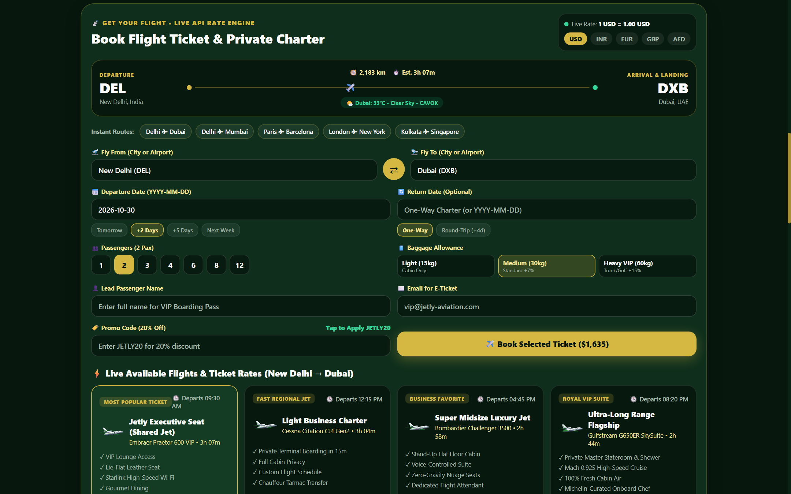 | 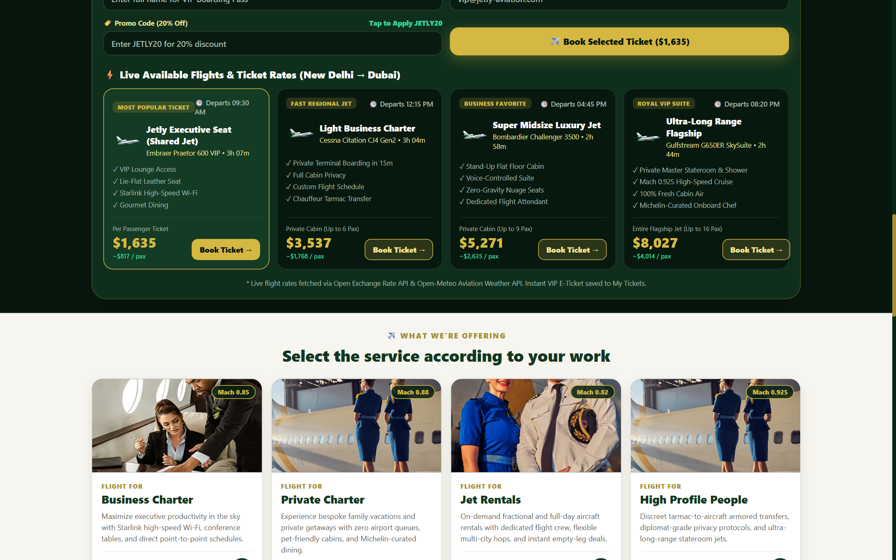 |
| **Screen 05 • Charter Services** | **Screen 06 • Reviews & Offer** | **Screen 07 • Empty-Leg Deals** | **Screen 08 • VIP Footer** |
| 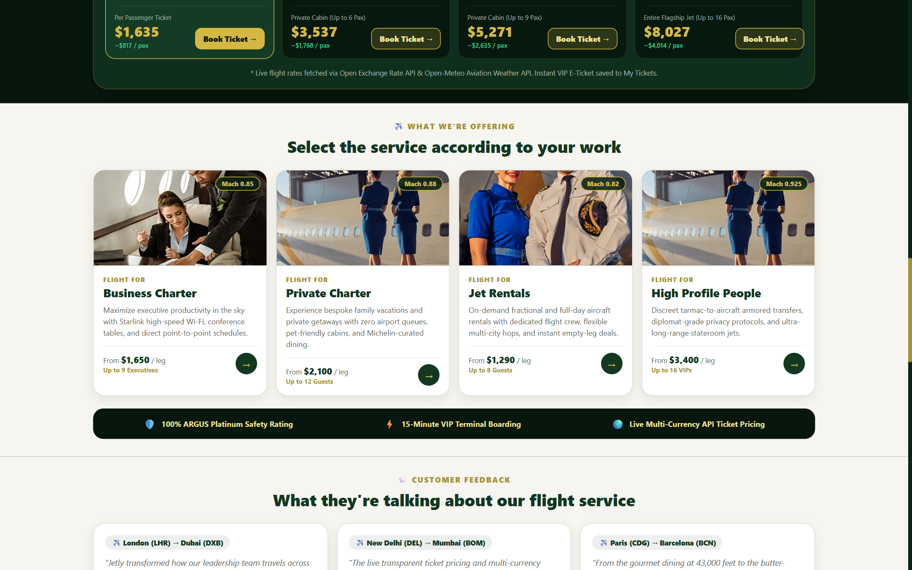 | 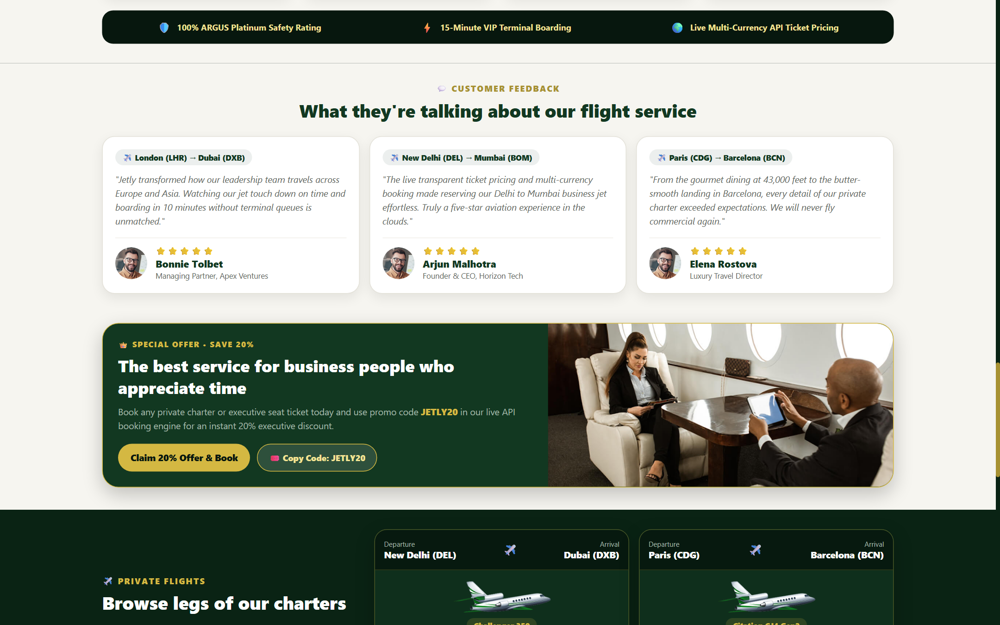 |  | 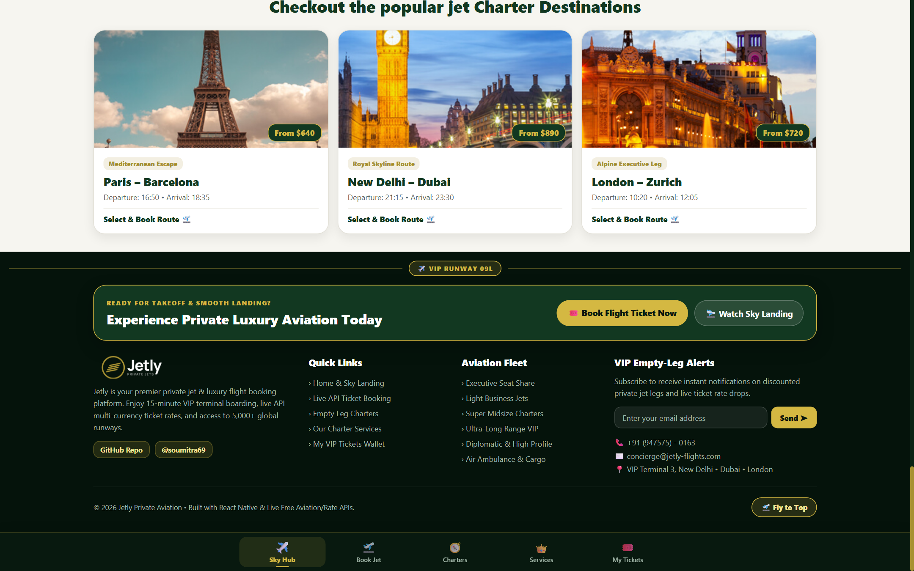 |

</details>

---

## ✨ Key Mobile Engineering Features

### 1. 🛫 60fps Native-Driver Sky-to-Runway Landing (`HeroSkyLanding.jsx`)
- Built with React Native's `Animated` API (`useNativeDriver: true`) using cubic-bezier interpolation for butter-smooth 60fps descent from `35,000 FT` to `0 FT` on Runway `09L / VIP`.
- **Live Flight Telemetry HUD**: Real-time altitude (`ALT`), airspeed (`SPD`), runway indicator (`RWY 09L / VIP`), and dynamic phase badges (`DESCENDING FROM SKY` → `TOUCHDOWN ON RUNWAY` → `LANDED AT VIP TERMINAL` → `CLIMBING TO SKY`).
- Visual effects include drifting atmospheric clouds, wing contrails, pulsing approach edge lights, tire touchdown smoke puffs, and dynamic ground shadow scaling.

### 2. 🎟️ Live Multi-Currency Booking Engine & Flight Radar (`FlightBookingSection.jsx`)
- **Animated Flight Route Radar**: Displays origin & destination IATA codes, Haversine great-circle distance (`km`), estimated flight block time, live destination weather badge, and an animated aircraft tracking along the flight corridor.
- **4 Bookable Private Aviation Tiers**:
  1. **Jetly Executive Seat (Shared Jet)** — *Embraer Praetor 600 VIP* (`820 km/h`)
  2. **Light Business Charter** — *Cessna Citation CJ4 Gen2* (`835 km/h`)
  3. **Super Midsize Luxury Jet** — *Bombardier Challenger 3500* (`870 km/h`)
  4. **Ultra-Long Range Flagship** — *Gulfstream G650ER SkySuite* (`956 km/h`)
- **Promo Engine**: Instant 20% executive discount with code `JETLY20` (or one-tap quick apply).

### 3. 🎫 Interactive VIP Boarding Pass & Persistent Wallet (`MyTicketsModal.jsx`)
- Generates a verified **VIP E-Ticket** with unique PNR (`JTL-XXXXX`), terminal gate (`VIP-01`–`VIP-04`), seat suite assignment, destination weather telemetry, and barcode.
- Native OS Share sheet integration via React Native's `Share.share()` API.
- Automatic persistence across app launches using `@react-native-async-storage/async-storage` with `localStorage` fallback.

---

## 🏗️ System Architecture & Data Flow

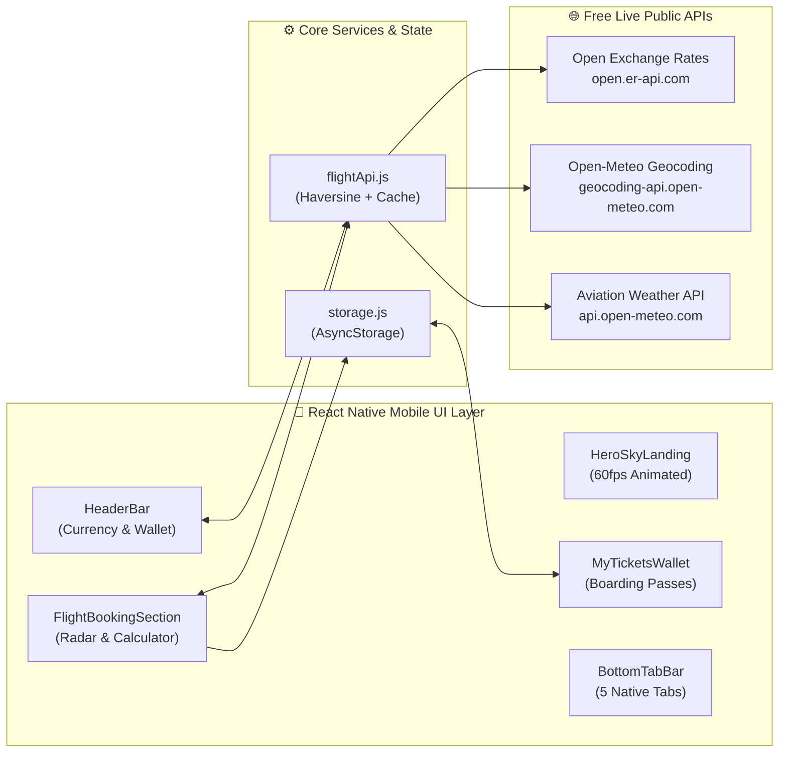

---

## 🛰️ Live Public API Integrations (Zero API Key Required)

| Service | Endpoint | Purpose in App | Caching Strategy |
| :--- | :--- | :--- | :--- |
| **Open Exchange Rates API** | `https://open.er-api.com/v6/latest/USD` | Real-time conversion across `USD ($)`, `INR (₹)`, `EUR (€)`, `GBP (£)`, and `AED (د.إ)` | Hydrated on app launch + offline fallback rates |
| **Open-Meteo Geocoding API** | `https://geocoding-api.open-meteo.com/v1/search` | Global city/airport autocomplete merged with 14 curated VIP jet terminals | In-memory `Map` query cache (`< 5ms` repeat lookup) |
| **Open-Meteo Weather API** | `https://api.open-meteo.com/v1/forecast` | Live destination temperature (`°C`), wind speed (`km/h`), and VFR/IFR condition | Coordinate-keyed in-memory weather cache |

---

## 📂 Project Structure

```text
Flight_Booking_App/
├── assets/                          # Normalized aircraft, cabin, destination & icon assets
│   └── screenshots/                 # 10 Retina mobile screenshots + auto-sliding SVG banners
├── src/
│   ├── components/
│   │   ├── HeaderBar.jsx            # Sticky top bar, currency modal & Phone Simulator toggle
│   │   ├── BottomTabBar.jsx         # 5-tab native bottom navigation bar with ticket badge
│   │   ├── HeroSkyLanding.jsx       # 60fps Sky-to-Runway jet landing animation & HUD
│   │   ├── ScreenGallerySlider.jsx  # In-app interactive sliding screen tour
│   │   ├── AboutSection.jsx         # Aviation stats strip, 18+ yrs badge & concierge cards
│   │   ├── FlightBookingSection.jsx # Live API booking form, radar, 4 jet tiers & E-Ticket
│   │   ├── ServicesSection.jsx      # 4 executive charter services & interactive detail sheet
│   │   ├── TestimonialsAndOffers.jsx# Reviews, 20% JETLY20 banner, empty legs & destinations
│   │   ├── MyTicketsModal.jsx       # Saved VIP Boarding Passes wallet & native Share integration
│   │   └── FooterSection.jsx        # VIP Runway 09L divider, empty-leg alerts & quick links
│   ├── data/
│   │   ├── assets.js                # Cross-platform Metro + React Native Web image resolver
│   │   └── siteData.js              # Curated fleet specs, charter legs, reviews & destinations
│   ├── services/
│   │   ├── flightApi.js             # Live currency, geocoding, weather APIs & Haversine pricing
│   │   └── storage.js               # AsyncStorage + localStorage persistence layer
│   └── theme/
│       └── theme.js                 # Luxury forest green & champagne gold design tokens
├── App.jsx                          # Root React Native application shell & navigation state
├── index.js                         # Expo / React Native native entry point
├── index.web.jsx                    # React Native Web AppRegistry entry point
├── app.json                         # Expo SDK 52 configuration (iOS, Android, New Arch)
├── vite.config.js                   # Lightning-fast React Native Web bundler configuration
└── package.json                     # Project scripts & dependencies
```

---

## 🚀 Getting Started

### Prerequisites
- **Node.js** `>= 18.x`
- **npm** `>= 9.x`
- *(Optional)* **Expo Go** app on iOS or Android for physical device testing

### Installation & Running Locally

```bash
# 1. Clone the repository
git clone https://github.com/soumitra69/Flight_Booking_App.git
cd Flight_Booking_App

# 2. Install dependencies
npm install --legacy-peer-deps

# 3. Start the ultra-fast React Native Web development server (< 500ms startup)
npm run dev

# 4. Or launch Expo Metro Bundler for iOS / Android (Expo Go)
npm run expo

# 5. Build production bundle
npm run build
```

---

## 👨‍💻 Author

<div align="center">

**Soumitra Samanta**  
*Full-Stack & React Native Mobile Developer*

[](https://github.com/soumitra69)
[](https://github.com/soumitra69/Flight_booking_Site)
[](https://github.com/soumitra69/Flight_Booking_App)

</div>
